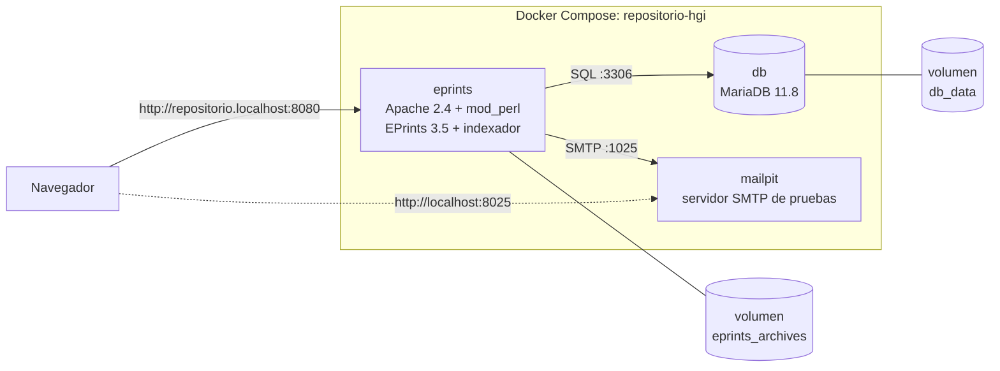

# Despliegue con Docker — Repositorio Digital HGI (EPrints 3.5)

Guía técnica para instalar, operar y mantener el Repositorio Digital de Producción Científica e Investigación del Hospital General de Itapúa con Docker.

**Contenido**

1. [Arquitectura](#1-arquitectura)
2. [Requisitos](#2-requisitos)
3. [Instalación paso a paso](#3-instalación-paso-a-paso)
4. [Qué ocurre en el primer arranque](#4-qué-ocurre-en-el-primer-arranque)
5. [Usuarios, roles y datos de prueba](#5-usuarios-roles-y-datos-de-prueba)
6. [Categorías (estructura médica)](#6-categorías-estructura-médica)
7. [Comandos de operación](#7-comandos-de-operación)
8. [Copias de seguridad y restauración](#8-copias-de-seguridad-y-restauración)
9. [Despliegue en un VPS](#9-despliegue-en-un-vps)
10. [Variables de entorno](#10-variables-de-entorno)
11. [Solución de problemas](#11-solución-de-problemas)
12. [Estructura de archivos](#12-estructura-de-archivos)

---

## 1. Arquitectura



| Servicio | Imagen | Función | Puerto publicado |
|---|---|---|---|
| `eprints` | `repositorio-hgi/eprints:3.5` (se construye con el `Dockerfile`) | Servidor web con EPrints. `supervisord` mantiene dos procesos: **Apache** (web) y el **indexador** (texto completo de los PDF, miniaturas y tareas en segundo plano) | `EPRINTS_PORT` (8080) |
| `db` | `mariadb:11.8` | Base de datos de metadatos, usuarios y categorías | ninguno (solo red interna) |
| `mailpit` | `axllent/mailpit:v1.27` | Recibe los correos que envía EPrints (registro, recuperar contraseña, avisos) y los muestra en una web, sin enviarlos a Internet | `127.0.0.1:8025` |

**Datos persistentes** (sobreviven a `docker compose down` y a reconstruir la imagen):

| Volumen | Contenido |
|---|---|
| `repositorio-hgi_db_data` | Base de datos MariaDB |
| `repositorio-hgi_eprints_archives` | `/opt/eprints3/archives/hgi`: configuración del repositorio, **PDF subidos** (`documents/`) y páginas generadas (`html/`) |

---

## 2. Requisitos

| Requisito | Detalle |
|---|---|
| Git | 2.30 o superior |
| Docker | Docker Desktop (Windows/macOS) o Docker Engine + plugin Compose v2 (Linux) |
| Windows | Windows 10/11 con **WSL2** activado (`wsl --install` en PowerShell como administrador) y virtualización habilitada en la BIOS |
| RAM | 4 GB libres como mínimo (8 GB recomendado) |
| Disco | ~3 GB para imágenes + el espacio de los documentos |
| Puertos libres | 8080 (repositorio) y 8025 (Mailpit), configurables en `.env` |

Comprobar la instalación:

```bash
git --version
docker --version
docker compose version
docker run --rm hello-world
```

---

## 3. Instalación paso a paso

### 3.1 Clonar el repositorio

```bash
git config --global core.longpaths true     # Windows: evita errores de rutas largas
git clone --recurse-submodules https://github.com/diegogabilan89-cmd/repositorio.git
cd repositorio
```

> **¿Olvidaste `--recurse-submodules`?** Puedes ejecutar `git submodule update --init`. Si no lo haces, no pasa nada: el `Dockerfile` detecta las carpetas vacías y descarga los submódulos (`pub_lib`, `easy_pages`, `richtext`, `latest_additions`) en la versión exacta.
>
> En Windows, clona en una ruta corta (por ejemplo `C:\proyectos\`) y no dentro de OneDrive.

### 3.2 Configurar el archivo `.env`

```bash
cp .env.example .env
```

Abre `.env` y **cambia todas las contraseñas**. Hay restricciones que impone EPrints y que el script de arranque comprueba:

- `EPRINTS_DB_PASSWORD`: solo letras, números y `_`, empezando por letra.
- Contraseñas de usuarios: 8 caracteres como mínimo, sin espacios ni comillas simples.
- `EPRINTS_HOSTNAME`: **no** puede ser `localhost` ni una IP. En local usa `repositorio.localhost`, que los navegadores resuelven a `127.0.0.1` automáticamente.

La tabla completa está en la sección [10](#10-variables-de-entorno).

### 3.3 Construir y levantar

```bash
docker compose up -d --build
```

- **Construcción** (solo la primera vez o tras cambiar el código): unos 5–15 minutos, según la conexión.
- **Primer arranque**: 1–3 minutos más, porque crea el repositorio.

Seguir el progreso:

```bash
docker compose logs -f eprints
```

Cuando aparezca esto, ya está funcionando (`Ctrl+C` sale de los logs sin detener nada):

```
[entrypoint] Repositorio listo en:  http://repositorio.localhost:8080/
```

Comprobar el estado. `eprints` debe aparecer como `healthy`:

```bash
docker compose ps
```

### 3.4 Entrar

| Qué | Dirección |
|---|---|
| Página pública | http://repositorio.localhost:8080 |
| Iniciar sesión | http://repositorio.localhost:8080/cgi/users/home |
| Correos capturados | http://localhost:8025 |

Si entras por `http://localhost:8080`, Apache te redirige al nombre correcto.

---

## 4. Qué ocurre en el primer arranque

El script [`docker/scripts/docker-entrypoint.sh`](../docker/scripts/docker-entrypoint.sh) hace esto:

1. **Valida** las variables de `.env`. Si alguna es incorrecta, se detiene con un mensaje claro en español.
2. **Espera** a que MariaDB esté disponible.
3. Si el repositorio no existe:
   1. Completa la plantilla [`docker/archive/archive.yml.tmpl`](../docker/archive/archive.yml.tmpl) con los valores de `.env`.
   2. Ejecuta `bin/epadmin create --config=...`, que es el instalador oficial de EPrints en modo no interactivo. Este paso crea:
      - el repositorio `archives/hgi` con el *flavour* de publicaciones (`pub`);
      - la base de datos, el usuario de MariaDB y todas las tablas;
      - el usuario **administrador**.
   3. Copia la personalización del hospital desde [`docker/archive/overlay`](../docker/archive/overlay).
   4. Importa las **categorías médicas** con `bin/import_subjects`.
4. **En cada arranque:**
   - reescribe el nombre de host, el puerto, el nombre del repositorio (en UTF-8) y el servidor de correo según `.env`;
   - regenera la configuración de Apache (`bin/generate_apacheconf`), las páginas estáticas (`generate_static`) y las vistas de navegación (`generate_views`).
5. Inicia `supervisord`, que arranca **Apache** y el **indexador**.

---

## 5. Usuarios, roles y datos de prueba

### 5.1 Roles de EPrints

| Rol (usertype) | Usuario de ejemplo | Qué puede hacer |
|---|---|---|
| `admin` | `admin` | Todo: configuración, usuarios, categorías, gestión de cualquier registro, estado del sistema |
| `editor` | `editor` | Revisar la cola de depósitos (**Review**), editar, aceptar o devolver registros, y publicarlos en el archivo |
| `user` | `investigador` | Depositar documentos (subir PDF y describirlos), ver y gestionar sus propios registros |

### 5.2 Crear usuarios y cargar los 3 PDF de prueba (automático)

```bash
docker compose exec eprints eprints-seed
```

El script [`eprints-seed`](../docker/scripts/eprints-seed):

- crea `editor` (rol editor) e `investigador` (rol user) con las contraseñas de `.env`;
- crea tres registros públicos con PDF ficticios, uno por categoría principal:

  | PDF | Tipo | Categoría |
  |---|---|---|
  | `investigacion_prevalencia_hipertension_2025.pdf` | Artículo | Investigación › Epidemiología / Investigación Clínica |
  | `tesis_adherencia_lactancia_materna.pdf` | Tesis | Tesis › Especialización y Residencia Médica |
  | `guia_manejo_inicial_sepsis_urgencias.pdf` | Monografía (manual) | Guías Clínicas › GPC / Protocolos |

Es idempotente: si se ejecuta varias veces, no duplica nada. Opciones: `--users` (solo usuarios) y `--docs` (solo documentos).

Después de 1–2 minutos, el indexador habrá extraído el texto de los PDF. Puedes probar la búsqueda de texto completo, por ejemplo buscando `lactato` o `puérperas`.

### 5.3 Hacerlo manualmente desde la web (recomendado para las capturas)

Los PDF están en [`docker/seed/pdfs/`](../docker/seed/pdfs). Para regenerarlos o cambiar su contenido: `perl docker/seed/generate_pdfs.pl`.

**Crear un usuario:** inicia sesión como `admin` → **Admin** → pestaña *System Tools* → **Create user** → elige el tipo (*User*, *Editor* o *Repository Administrator*) → completa nombre, correo y contraseña.

**Depositar un documento (como `investigador`):**

1. **Manage deposits** → **New Item**.
2. **Type**: Article / Thesis / Monograph…
3. **Upload**: sube el PDF.
4. **Details**: título, resumen, autores, fecha…
5. **Subjects**: elige la categoría (Investigación, Tesis, Guías Clínicas…).
6. **Deposit** → *Deposit Item Now*. El registro pasa a la cola de revisión.

**Revisar y publicar (como `editor`):** **Review** → abre el registro → **Move to Repository**. Queda público.

> Este flujo depositante → revisor → publicado es una buena evidencia de que los roles funcionan.

### 5.4 Cambiar contraseñas después

- **Usuarios de EPrints:** desde la web (perfil del usuario, o **Admin** → buscar usuario → *Edit*). Cambiar `.env` **no** modifica las cuentas existentes.
- **Base de datos:** se fijan al crear el repositorio. Para cambiarlas hay que hacerlo en MariaDB y en `archives/hgi/cfg/cfg.d/database.pl`. En un entorno de pruebas es más sencillo reiniciar desde cero ([sección 7](#7-comandos-de-operación)).

---

## 6. Categorías (estructura médica)

Definidas en [`docker/archive/overlay/cfg/subjects`](../docker/archive/overlay/cfg/subjects) e importadas al crear el repositorio:

```
Áreas Temáticas
├── Investigación
│   ├── Investigación Clínica
│   ├── Epidemiología y Salud Pública
│   ├── Ciencias Biomédicas Básicas
│   ├── Investigación en Enfermería
│   └── Reportes de Casos Clínicos
├── Tesis
│   ├── Tesis de Grado
│   ├── Tesis de Especialización y Residencia Médica
│   ├── Tesis de Maestría
│   └── Tesis Doctoral
└── Guías Clínicas
    ├── Guías de Práctica Clínica
    ├── Protocolos de Atención
    ├── Manuales de Procedimientos
    └── Guías de Cuidados de Enfermería

Estructura del Hospital (campo "Divisions")
├── Dirección Médica
│   ├── Departamento de Docencia e Investigación
│   ├── Servicio de Medicina Interna · Cirugía General · Pediatría
│   ├── Ginecología y Obstetricia · Urgencias · Terapia Intensiva
│   └── Laboratorio Clínico · Diagnóstico por Imágenes
└── Dirección de Enfermería
    └── Departamento de Enfermería
```

- **Editar desde la web:** **Admin** → pestaña *Config. Tools* → **Edit subject** (añadir, renombrar o mover categorías).
- **Navegar públicamente:** menú **Browse** → *Subjects* / *Divisions* / *Year*.
- **Reimportar el archivo** (borra las categorías actuales y las recrea):

  ```bash
  docker compose exec -u eprints eprints bin/import_subjects --force hgi
  ```

---

## 7. Comandos de operación

Todos se ejecutan desde la carpeta del proyecto.

| Acción | Comando |
|---|---|
| Ver estado y salud | `docker compose ps` |
| Ver logs (todos / uno) | `docker compose logs -f` · `docker compose logs -f eprints` |
| Detener (conserva los datos) | `docker compose stop` |
| Iniciar de nuevo | `docker compose start` |
| Apagar y eliminar contenedores (conserva volúmenes) | `docker compose down` |
| Aplicar cambios de `.env` | `docker compose up -d` |
| Reconstruir tras cambiar código o `Dockerfile` | `docker compose up -d --build` |
| Consola dentro del contenedor | `docker compose exec eprints bash` |
| Estado de Apache e indexador | `docker compose exec eprints supervisorctl status` |
| Reiniciar solo Apache (tras editar `cfg.d`) | `docker compose exec eprints supervisorctl restart apache2` |
| Estado del indexador | `docker compose exec -u eprints eprints bin/indexer status` |
| Regenerar páginas estáticas | `docker compose exec -u eprints eprints bin/generate_static hgi` |
| Regenerar vistas de navegación | `docker compose exec -u eprints eprints bin/generate_views hgi` |
| Consola SQL | `docker compose exec db mariadb -uroot -p hgi` |
| **Reiniciar desde cero (BORRA TODO)** | `docker compose down -v` y luego `docker compose up -d` |

> Los comandos de EPrints (`bin/...`) deben ejecutarse como usuario `eprints`, por eso llevan `-u eprints`.
>
> **Git Bash en Windows:** convierte las rutas que empiezan por `/` (por ejemplo `/data` o `/opt/...`) en rutas de Windows, y eso rompe los comandos `docker`. Antepón `MSYS_NO_PATHCONV=1`, por ejemplo `MSYS_NO_PATHCONV=1 docker run ... -C /data .`, o usa PowerShell. Los comandos de la tabla anterior no se ven afectados.

**Pantallas útiles de la web (como `admin`, menú Admin):**

| Pestaña | Botón | Para qué |
|---|---|---|
| *Editorial Tools* | Search users / Search items | Listar usuarios (con su rol) y registros |
| *System Tools* | Status | Versión, base de datos, **estado del indexador**, usuarios por rol, nº de documentos |
| *System Tools* | Create user | Crear cuentas |
| *System Tools* | Send Test Email | Probar el correo (llega a Mailpit) |
| *System Tools* | Regenerate Views | Actualizar las páginas de navegación |
| *Config. Tools* | Edit subject | Editar el árbol de categorías |
| *Config. Tools* | Phrase Editor | Cambiar textos de la interfaz |

---

## 8. Copias de seguridad y restauración

Una copia completa tiene dos partes: la **base de datos** y el volumen de **archivos**.

**Linux / macOS** (en Git Bash para Windows, ejecuta antes `export MSYS_NO_PATHCONV=1`):

```bash
mkdir -p backups
# 1) Base de datos (contraseña: MARIADB_ROOT_PASSWORD)
docker compose exec -T db sh -c 'exec mariadb-dump -uroot -p"$MARIADB_ROOT_PASSWORD" --single-transaction --databases hgi' > backups/hgi-db.sql
# 2) Documentos y configuración del repositorio
docker run --rm -v repositorio-hgi_eprints_archives:/data -v "$PWD/backups":/backup debian:trixie-slim tar czf /backup/hgi-archives.tar.gz -C /data .
```

**Restaurar** en una instalación nueva (con el mismo `.env`):

```bash
docker compose up -d db
docker compose exec -T db sh -c 'exec mariadb -uroot -p"$MARIADB_ROOT_PASSWORD"' < backups/hgi-db.sql
docker volume create repositorio-hgi_eprints_archives
docker run --rm -v repositorio-hgi_eprints_archives:/data -v "$PWD/backups":/backup debian:trixie-slim tar xzf /backup/hgi-archives.tar.gz -C /data
docker compose up -d
```

> El usuario de MariaDB que usa EPrints (`EPRINTS_DB_USER`) se crea al instalar. En una restauración sobre un servidor de base de datos nuevo hay que recrearlo:
> `CREATE USER 'hgi'@'%' IDENTIFIED BY '<EPRINTS_DB_PASSWORD>'; GRANT ALL ON hgi.* TO 'hgi'@'%';`

---

## 9. Despliegue en un VPS

Probado como guía para Ubuntu 22.04/24.04 o Debian 12/13.

1. **Instalar Docker Engine** (script oficial):

   ```bash
   curl -fsSL https://get.docker.com | sudo sh
   sudo usermod -aG docker $USER     # cerrar sesión y volver a entrar
   ```

2. **Clonar** el repositorio y crear `.env` (pasos 3.1 y 3.2).

3. En `.env`:

   ```ini
   # Con dominio propio (registro DNS tipo A apuntando a la IP del VPS):
   EPRINTS_HOSTNAME=repositorio.midominio.com
   # ...o sin dominio, usando la IP con nip.io (resuelve a esa IP):
   EPRINTS_HOSTNAME=203.0.113.10.nip.io
   EPRINTS_PORT=80
   ```

4. **Abrir el puerto** en el cortafuegos:

   ```bash
   sudo ufw allow 80/tcp
   ```

5. **Levantar:**

   ```bash
   docker compose up -d --build
   ```

   Después, entrar en `http://<EPRINTS_HOSTNAME>/`.

6. **Mailpit** solo escucha en `127.0.0.1` del VPS. Para verlo desde tu PC, abre un túnel SSH:

   ```bash
   ssh -L 8025:localhost:8025 usuario@IP_DEL_VPS
   ```

   Luego abre http://localhost:8025 en tu navegador.

**HTTPS (opcional).** La imagen sirve HTTP. Para HTTPS en producción, lo habitual es poner delante un proxy inverso con certificados automáticos (Caddy, Traefik o Nginx + Certbot). Además, EPrints debe configurarse con `securehost`/`secureport`. Esta parte no está incluida en el despliegue de pruebas.

---

## 10. Variables de entorno

| Variable | Por defecto | Descripción |
|---|---|---|
| `ARCHIVE_ID` | `hgi` | Identificador interno del repositorio y nombre de la base de datos. No cambiar después de crearlo |
| `EPRINTS_ARCHIVE_NAME` | Repositorio Digital de Producción Científica e Investigación | Nombre visible (admite tildes) |
| `EPRINTS_ORG_NAME` | Hospital General de Itapúa | Nombre de la institución |
| `EPRINTS_HOSTNAME` | `repositorio.localhost` | Nombre de host de acceso. No puede ser `localhost` ni una IP |
| `EPRINTS_PORT` | `8080` | Puerto web (el mismo dentro y fuera del contenedor) |
| `MARIADB_ROOT_PASSWORD` | — | Contraseña de `root` de MariaDB |
| `EPRINTS_DB_USER` | `hgi` | Usuario de MariaDB para EPrints |
| `EPRINTS_DB_PASSWORD` | — | Su contraseña. Solo `[A-Za-z0-9_]`, empezando por letra |
| `EPRINTS_ADMIN_USER` / `_PASSWORD` / `_EMAIL` | `admin` / — / `admin@hgi.localhost` | Administrador inicial |
| `EPRINTS_EDITOR_USER` / `_PASSWORD` | `editor` / — | Editor creado por `eprints-seed` |
| `EPRINTS_DEPOSITOR_USER` / `_PASSWORD` | `investigador` / — | Depositante creado por `eprints-seed` |
| `EPRINTS_SMTP_SERVER` | `mailpit:1025` | Servidor SMTP (`host:puerto`) |
| `MAILPIT_PORT` | `8025` | Puerto local de la web de Mailpit |
| `APACHE_MAX_REQUEST_WORKERS` | `20` | Máximo de procesos Apache (cada uno usa ~60–100 MB) |

---

## 11. Solución de problemas

| Síntoma | Causa y solución |
|---|---|
| `docker compose` dice que no encuentra `.env` | Falta crear el archivo: `cp .env.example .env` |
| `Bind for 0.0.0.0:8080 failed: port is already allocated` | Otro programa usa el puerto. Cambia `EPRINTS_PORT` en `.env` (p. ej. `8081`) y ejecuta `docker compose up -d` |
| El log dice `EPRINTS_HOSTNAME no puede ser 'localhost'` | Usa `repositorio.localhost` (local) o `<IP>.nip.io` (VPS) |
| El navegador no abre `repositorio.localhost` | Usa Chrome, Edge o Firefox (resuelven `*.localhost` solos). Si no, añade `127.0.0.1 repositorio.localhost` a `C:\Windows\System32\drivers\etc\hosts` (o `/etc/hosts`) |
| `El repositorio 'hgi' quedó a medio crear` | Un primer arranque falló a mitad (p. ej. contraseña inválida). Corrige `.env` y ejecuta `docker compose down -v` seguido de `docker compose up -d` |
| `/bin/bash^M: bad interpreter` o errores raros en scripts | Finales de línea de Windows. El repo incluye `.gitattributes`. Vuelve a clonar, o ejecuta `git rm -r --cached . && git reset --hard` |
| Los PDF no aparecen en la búsqueda de texto completo | El indexador tarda 1–2 minutos. Comprueba con `docker compose exec eprints supervisorctl status` y `docker compose logs eprints \| grep indexer` |
| Error de memoria o contenedores que se reinician en un VPS pequeño | Baja `APACHE_MAX_REQUEST_WORKERS` (p. ej. `8`) y añade *swap* al VPS |
| Docker Desktop: `error during connect` | Docker Desktop no está abierto. Inícialo y espera a que diga *Engine running* |
| La construcción falla descargando submódulos | Sin acceso a GitHub. Clona con `--recurse-submodules` para que no haga falta descargarlos durante la construcción |
| El log repite `Attempt to call undefined import method with arguments (":template_phrase")` | **Normal, no es un error.** Es un aviso de Perl 5.40 sobre una línea del propio código de EPrints. No afecta al funcionamiento |
| El log muestra `Exiting eval via last at .../Index/Daemon.pm` | **Normal.** El indexador de EPrints se reinicia a propósito después de ciertas tareas |
| `CRIT Server 'unix_http_server' running without any HTTP authentication` | **Normal.** Es el socket interno de `supervisorctl`, accesible solo por `root` dentro del contenedor |
| Errores `Failed to parse XML file: .../citations/.../panel_*.xml` | Los enlaces simbólicos del repositorio se clonaron como texto (Windows). El `Dockerfile` los restaura solo; si ves el error, reconstruye con `docker compose build --no-cache` |

Diagnóstico general:

```bash
docker compose ps
docker compose logs --tail=200 eprints
docker compose exec eprints supervisorctl status
docker compose exec -u eprints eprints bin/epadmin test hgi
```

---

## 12. Estructura de archivos

```
.
├── Dockerfile                    # Imagen EPrints 3.5 (2 etapas: código fuente → imagen final)
├── docker-compose.yml            # Servicios eprints + db + mailpit
├── .env.example                  # Plantilla de variables (copiar a .env)
├── .dockerignore / .gitattributes / .gitmodules
├── docker/
│   ├── apache/
│   │   ├── eprints.conf          # Config. global de Apache (logs, límites, cabeceras)
│   │   └── ports.conf            # Listen ${EPRINTS_PORT}
│   ├── supervisord.conf          # Procesos: apache2 + indexer
│   ├── scripts/
│   │   ├── docker-entrypoint.sh  # Arranque: crea/sincroniza el repositorio
│   │   ├── eprints-indexer-supervised  # Vigila el indexador de EPrints
│   │   └── eprints-seed          # Usuarios con roles + 3 PDF de prueba
│   ├── archive/
│   │   ├── archive.yml.tmpl      # Respuestas para `epadmin create`
│   │   └── overlay/cfg/          # Personalización copiada al repositorio
│   │       ├── subjects          #   categorías médicas
│   │       └── cfg.d/zz_hgi.pl   #   idioma por defecto, tamaño de subida
│   └── seed/
│       ├── generate_pdfs.pl      # Genera los PDF de prueba
│       └── pdfs/                 # Los 3 PDF de prueba
├── docs/
│   ├── DESPLIEGUE_DOCKER.md      # Esta guía
│   └── GUIA_ENTREGA.md           # Lista de comprobación para el informe
└── (código de EPrints: bin/, cgi/, lib/, perl_lib/, flavours/, ingredients/ ...)
```
